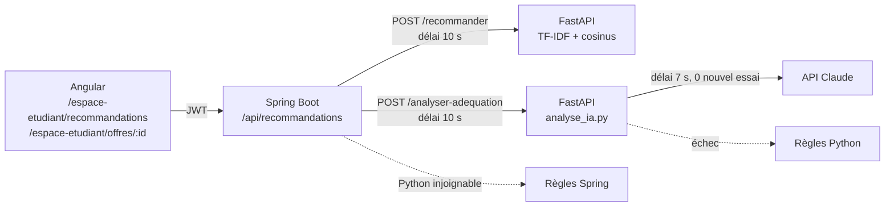

# Maîtrise technique

## 1. Architecture



- **Source unique de vérité** : Spring lit la base et envoie au service Python le profil et les offres
  publiées. Le service Python ne stocke rien (sans état), on peut le redémarrer ou le dupliquer librement.
- **Dégradation progressive** : Claude → règles Python → règles Spring → liste vide. À chaque niveau,
  l'étudiant obtient une réponse et l'interface dit d'où elle vient (`source`).
- **Délais en cascade** : Claude 7 s < Spring 10 s. Aucun nouvel essai côté SDK, sinon
  `timeout × (max_retries + 1)` dépasserait la limite de Spring.

## 2. Classement : TF-IDF et similarité cosinus

Chaque texte (profil, offre) devient un vecteur dont chaque dimension est un terme du corpus.

- **TF** : nombre d'occurrences du terme *t* dans le document *d*.
- **IDF** (version lissée de scikit-learn) : `idf(t) = ln((1 + n) / (1 + df(t))) + 1`, où *n* est le
  nombre de documents et *df(t)* le nombre de documents contenant *t*. Un terme présent dans toutes
  les offres (« stage ») pèse peu, un terme rare (« Kubernetes ») pèse beaucoup.
- **Poids** : `tfidf(t, d) = tf(t, d) × idf(t)`, puis normalisation L2 de chaque vecteur.
- **Cosinus** : `cos(u, v) = u·v / (‖u‖ ‖v‖)`. Les poids étant positifs, le score est entre 0 et 1.
  Il ne dépend pas de la longueur du texte : une offre longue n'est pas favorisée.

Prétraitement choisi après évaluation (voir [justification-modeles.md](justification-modeles.md)) :

| Réglage | Problème corrigé |
|---|---|
| `strip_accents="unicode"` | « Systemes embarques » (tapé sans accents) ne correspondait pas à « Systèmes embarqués » |
| Mots vides français | « de », « et », « la » créaient de la similarité entre textes sans rapport |
| `token_pattern` personnalisé | Le motif par défaut `\b\w\w+\b` supprime `C`, `R`, et coupe `C++`, `C#` : un profil « C, C++ » obtenait 0 partout |

Limite connue : TF-IDF compare des mots, pas des sens. « Apprentissage automatique » et
« Machine Learning » n'ont aucun mot commun. C'est la raison du LLM pour l'analyse d'une offre.

## 3. Analyse d'adéquation par LLM

**Appel** : SDK officiel `anthropic` (client asynchrone, pour ne pas bloquer la boucle d'événements de
FastAPI), modèle `claude-opus-5-5`, `effort: "low"`, `max_tokens: 4000`.

**Sortie structurée** : `output_config.format` avec un schéma JSON. Le modèle ne peut produire
qu'un JSON conforme (décodage contraint). Le JSON est malgré tout revalidé par Pydantic : si la
validation échoue, on passe aux règles.

**Le LLM ne décide pas du score.** Il dit seulement, pour chaque compétence requise, si elle est
couverte et pourquoi. Le service recalcule :

```
score = 0,65 × (compétences couvertes / compétences requises) + 0,35 × similarité TF-IDF
```

Ainsi un texte d'offre manipulé ne peut pas imposer « 100 % », et le score reste comparable entre
les modes IA et règles.

**Garde-fous** (tous testés dans [test_service.py](../../recommandation-service/test_service.py)) :

| Risque | Parade |
|---|---|
| Compétence inventée par le modèle | Ignorée : seules les compétences de l'offre sont retenues |
| Compétence oubliée par le modèle | Évaluée par les règles |
| Injection de consignes dans une offre (« ignore tes instructions ») | Données entre balises `<offre>`, consigne explicite de les traiter comme des données, score calculé hors LLM |
| Données personnelles | Ni identifiant, ni nom, ni email envoyés : filière, niveau, compétences seulement |
| Délai, coupure réseau, quota (429), erreur 5xx | Exceptions typées du SDK, repli sur les règles |
| Refus de sécurité | Repli serveur `fallbacks: "default"` puis, si refus final, règles |
| Coût et latence en cas de rechargement | Cache LRU de 256 analyses |
| Étudiant trompé sur l'origine | Badge « Analyse IA » seulement si `source = ia`, mention « peut se tromper » |

## 4. Correspondance des compétences par règles

L'ancienne version comparait des sous-chaînes (`a in b`). Conséquence : « Java » était trouvé dans
« JavaScript », « R » dans « React », « C » dans « C++ », « SQL » dans « NoSQL ». La nouvelle version
normalise (minuscules, sans accents, synonymes : ML, JS, TS, K8s, IA...) puis compare des ensembles
de **mots** : « Spring » ⊂ « Spring Boot » correspond, « Java » ≠ « JavaScript » ne correspond pas.
La même règle est appliquée côté Spring pour le repli local.

## 5. Génie logiciel

- **Contrat entre trois langages** : les DTO Pydantic, Java et TypeScript portent les mêmes champs.
  Les nouveaux champs (`source`, `modele`, `synthese`, `correspondances`) ont des valeurs par défaut :
  un client plus ancien continue de fonctionner.
- **Configuration externe** : clé, modèle, effort, délai et activation par variables d'environnement ;
  délai Spring par `recommandation.service.timeout-seconds`.
- **Tests sans réseau** : le client Claude est remplacé par un faux client (Python) et le `RestTemplate`
  par un mock Mockito (Java). Les tests ne coûtent rien et passent hors ligne.
- **Pyramide de tests** : tests unitaires (Python, Java, Angular), tests de sécurité MockMvc
  (401 anonyme, 403 entreprise), puis un scénario de bout en bout sur les vrais serveurs
  ([scenario_bout_en_bout.py](../../recommandation-service/scenario_bout_en_bout.py)) qui vérifie
  aussi le repli quand le service Python est arrêté.
- **Observabilité** : chaque appel au LLM journalise modèle, durée et jetons consommés, sans données
  personnelles.

## 6. Outils d'IA générative utilisés

| Outil | Usage |
|---|---|
| Claude Code (modèle Claude Opus 5.5), dans VS Code | Lecture des trois projets, analyse de l'écart avec la grille, implémentation, tests, évaluation, documentation. Détail dans [journal-prompts.md](journal-prompts.md) |
| API Claude (`claude-opus-5-5`) | Composant de l'application : analyse d'adéquation |
| _À compléter : autres outils utilisés (Copilot, ChatGPT...)_ | |
